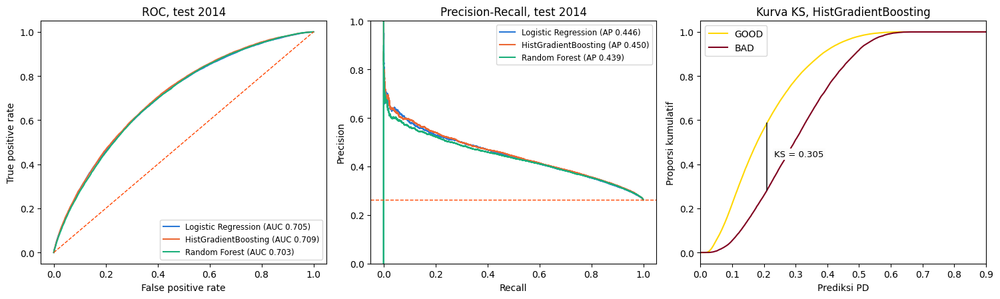

# Credit Risk Prediction

End-to-end machine learning project that estimates the probability of default at loan application.
Built as the final task of the ID/X Partners x Rakamin Academy Project-Based Internship (Data Scientist).

## Business problem

A multifinance company must approve or reject a loan before knowing whether the borrower will repay.
Too loose loses principal, and too strict loses interest income. In this dataset, one bad loan wipes out the
profit of about 3.7 good loans on average ($7,599 loss against $2,038 profit, before funding and operating costs).

**Problem statement:** how can we predict default risk at application, so losses fall without rejecting too many good borrowers?

## Data

- [Loan dataset, 2007-2014](https://rakamin-lms.s3.ap-southeast-1.amazonaws.com/vix-assets/idx-partners/loan_data_2007_2014.csv): 466,285 approved loans and 75 columns
- 237,695 loans have a known outcome: 186,727 GOOD and 50,968 BAD (21.44% bad rate)
- Loans that are still running or only slightly late are excluded, because their outcome is not known yet

The CSV is not stored in this repository because of its size.

## Approach

| Stage | What was done |
|---|---|
| Data understanding | Structure, missing values, descriptive statistics, GOOD/BAD label from `loan_status` |
| EDA | Univariate and bivariate analysis, correlation, K-Means and PCA segmentation |
| Data preparation | Removed post-loan columns (data leakage), feature engineering, median imputation, winsorizing, one-hot encoding, scaling |
| Modelling | Logistic Regression, HistGradientBoosting, Random Forest, with grid and randomized search |
| Evaluation | Out-of-time test: trained on loans up to December 2013, tested on loans issued in 2014 |

## Results

| Model | AUC (CV) | AUC (test) | KS (test) | Train-test AUC gap |
|---|---:|---:|---:|---:|
| **HistGradientBoosting (selected)** | 0.712 | 0.709 | 0.306 | 0.026 |
| Logistic Regression | 0.705 | 0.705 | 0.299 | 0.001 |
| Random Forest | 0.705 | 0.703 | 0.300 | 0.027 |

- The actual bad rate rises from 5.5% in the safest score band to 49.6% in the riskiest
- Score stability is acceptable, with a PSI of 0.088
- Using post-loan columns gives an AUC of 0.999, which is invalid because those values do not exist at application



## Proposed policy

Figures are from the 2014 test set.

| Probability of default | Action | Share of applications | Actual bad rate |
|---|---|---:|---:|
| Below 0.19 | Fast-track | 46.2% | 13.7% |
| 0.19 to 0.35 | Manual review | 34.2% | 30.6% |
| 0.35 and above | Reject or require collateral | 19.6% | 48.0% |

Rejecting the top-risk group lowers the portfolio bad rate from 26.2% to 20.9%.

## Limitations

- **Profit gain is not proven.** On fully observed 36-month loans, every risk group stayed profitable, and rejecting the riskiest group slightly lowered net cash flow ($76.17M to $75.25M). The reject cutoff needs the client's cost data.
- **Time bias.** 67.3% of 2014 loans were still running and excluded, so their observed 26.2% bad rate is inflated compared with 13.1% on fully observed loans.
- **Selection bias.** The file contains approved loans only, so the model never sees rejected applicants.
- **Different market.** The model must be validated and retrained on the client's own data before use.

## Live demo

`app.py` is a Streamlit app that scores a new application and shows its probability of default, risk band and recommended action. It can also score a whole CSV at once and download the results; `sample_applications.csv` is a ready-to-try example of 50 loans from 2014.

Demo link: [Streamlit app link]

It is a portfolio demo, not a validated credit decision tool.

## Repository contents

| File | Description |
|---|---|
| `credit_risk_prediction.ipynb` | Full notebook with outputs and an explanation of each result (in Indonesian) |
| `credit_risk_prediction.py` | The same code as a Python script |
| `credit_risk_analysis.sql` | SQL workflow for data checks, analysis and the modeling dataset (PostgreSQL) |
| `app.py` | Streamlit demo app |
| `sample_applications.csv` | 50 sample loans for the app's batch scoring |
| `credit_risk_lib.py` | Feature engineering shared by the app and the training script |
| `train_model.py` | Trains and saves the model used by the app |
| `model/` | Saved model and its cutoffs |
| `outputs/` | Charts |
| `requirements.txt` | Python dependencies |

## How to run

```bash
pip install -r requirements.txt
```

Download the dataset, save it next to the script as `loan_data_2007_2014.csv`, then run:

```bash
python credit_risk_prediction.py
```

To use a different location, set `LOAN_DATA_PATH` before running. In Google Colab:

```python
import os
os.environ["LOAN_DATA_PATH"] = "/content/drive/MyDrive/your-folder/loan_data_2007_2014.csv"
```

Section 5.7 of the notebook shows sample predictions for new applications.

To run the app:

```bash
streamlit run app.py
```

If the saved model does not load in your environment, retrain it with `python train_model.py loan_data_2007_2014.csv`.

## Author

Rahma Novita | [www.linkedin.com/in/rahmanovitasari]
